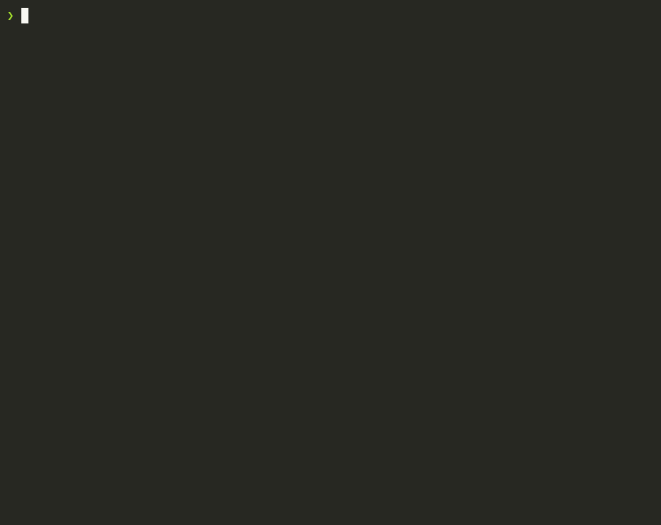
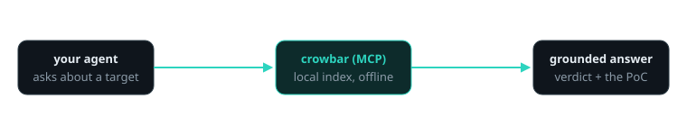

<!-- mcp-name: io.github.kushvinth/crowbar -->
<div align="center">

# crowbar

### Retrieve CVEs and index them inside your codebase.

**Point it at a product and version. It pulls the CVEs that apply and indexes them locally, so any tool in your repo can query the answer.**

[](https://www.npmjs.com/package/crowbar-cli)
[](https://pypi.org/project/crowbar-cli/)
[](https://github.com/kushvinth/crowbar/actions/workflows/ci.yml)
[](#other-agents-cursor-codex-gemini-opencode)
[](#prefer-a-plain-cli)
[](https://skills.sh/kushvinth/crowbar/crowbar)
[](LICENSE)

**[Website](https://crowbar.kushvinth.com/) · [Guides](https://crowbar.kushvinth.com/guides/) · [Showcases](https://crowbar.kushvinth.com/showcase/)**

[Quick start](#quick-start) · [How crowbar works](#how-crowbar-works) · [What you can answer](#what-you-can-answer) · [Showcases](#showcases) · [FAQ](#faq) · [Documentation](#documentation)

<code>npx crowbar-cli setup</code>

</div>

> [!IMPORTANT]
> Get crowbar from [kushvinth/crowbar](https://github.com/kushvinth/crowbar),
> [crowbar.kushvinth.com](https://crowbar.kushvinth.com), or the
> [crowbar-cli](https://pypi.org/project/crowbar-cli/) package. A similar
> repository name or copied README does not make a download official.

<p align="center">
  
</p>

---

A codebase with no CVE index inside it makes people guess. crowbar is the
index: it retrieves NVD, CISA KEV, EPSS, SSVC, the CVE List, Exploit-DB, Nuclei,
Metasploit, OSV, Debian, MSRC and Apple advisories, and writes them into a local
SQLite + FTS5 database you query from your terminal, your CI or your agent. It
is **offline and reproducible** - the same query gives the same answer, no API,
no rate limits - so a lookup costs milliseconds instead of a guess.

No web UI, no daemon, no third-party Python packages. Point it at a product and
version and it tells you what is actually exploitable, ranks it by real-world
risk, and links the proof-of-concept.

> crowbar indexes public exploit and PoC data **as data**. It never clones,
> compiles, or runs it. Treat anything it surfaces as hostile code and detonate
> only in a disposable VM. Use it only against systems you own or may test. See
> [DISCLAIMER.md](DISCLAIMER.md).

## Quick start

### Set up your agent

With Node.js and [uv](https://docs.astral.sh/uv/) installed, run:

```bash
npx crowbar-cli setup
```

Setup finds Claude Code, Codex, Cursor, Gemini CLI and opencode on your machine,
shows exactly which configs it will change, and applies them only after you
approve. It registers crowbar's MCP server, installs the skill, backs up every
config file it edits, and offers to build the local index. Restart your agent
afterward. `--agents claude,cursor` picks agents explicitly; `--yes` skips the
prompts. `npx crowbar-cli setup --remove` undoes it the same way: it lists what
it will remove, asks first, and leaves your other servers and the index alone.

### Or install the Claude Code plugin

One install drops in a skill *and* an MCP server:

```bash
claude plugin marketplace add kushvinth/crowbar
claude plugin install crowbar@crowbar
```

Your agent now has:

- the **skill** - it reaches for crowbar on any "is X vulnerable / what CVEs hit
  this / known exploits for …" question instead of guessing from memory;
- the **MCP tools** - `cb_cve`, `cb_product`, `cb_search`, `cb_exploit`, … answering
  offline from the local index.

**That's the whole setup.** The first time you ask a security question, the
crowbar skill sets itself up automatically - installs the tool and builds a
small local index in `~/.crowbar` (~150 MB; a few minutes, since NVD downloads are
slow), then answers. You never run a CLI command, and the index refreshes itself
once a day while you use it.

### Other agents (Cursor, Codex, Gemini, opencode)

Same MCP server, one line - no heavy install, `uvx` runs it on demand:

```json
{ "command": "uvx", "args": ["--from", "crowbar-cli", "crowbar-mcp"] }
```

```bash
claude mcp add crowbar -- uvx --from crowbar-cli crowbar-mcp   # or, manually, in Claude Code
```

The repo ships `.claude-plugin/`, `.codex-plugin/`, `gemini-extension.json` and a
host-agnostic `skills/crowbar/SKILL.md`, so most hosts auto-detect it.

### Prefer a plain CLI?

Everything the agent can do, you can do in the terminal. Python 3.11+, zero deps.

```bash
uvx crowbar-cli                 # run without installing
uv tool install crowbar-cli     # or pipx install crowbar-cli / pip install crowbar-cli
nix run github:kushvinth/crowbar
git clone https://github.com/kushvinth/crowbar && cd crowbar && ./bin/crowbar --help
```

### Build an index

```bash
crowbar sync --tier lite    # pick lite | medium | heavy | extreme
crowbar build --tier lite   # build the local index
crowbar doctor              # verify it's ready
```

With `uvx`, prefix each: `uvx crowbar-cli sync --tier lite`. Refresh later with
`crowbar update` (~10 s) - NVD modified + KEV + EPSS + Exploit-DB, in place.

**Size tiers** - each a superset of the one above, so you pick your disk budget:

| tier | size | includes |
|---|---|---|
| `lite` | ~150 MB | KEV, EPSS, recent CVEs, CWE names |
| `medium` | ~500 MB | + full NVD history, CAPEC, SSVC, ATT&CK |
| `heavy` | ~2 GB | + Exploit-DB, Nuclei, Metasploit, OSV, PoC |
| `extreme` | full | + MSRC, Apple, Debian - every source |

## How crowbar works



Your agent asks crowbar about a target over MCP. crowbar answers from the local
index - never the network - with the KEV/SSVC/EPSS/CVSS verdict, the affected
version ranges, and links to working PoCs. The agent uses that grounded result
to explain the risk, decide what to patch, or write and test an exploit under
authorization. CLI commands use the same read layer.

## What you can answer

| Ask | What crowbar returns | Command |
|---|---|---|
| What does this CVE mean, and is it serious? | CVSS, EPSS, KEV, SSVC, CWE, CPE ranges, refs, PoCs | `crowbar cve CVE-2021-44228` |
| We run product X version Y - what's exploitable? | Only CVEs whose CPE range covers Y, with the matched range | `crowbar product nginx --version 1.18.0` |
| Is it exploited in the wild? | CISA KEV + SSVC `active`/`poc`/`none` | `crowbar kev`, `crowbar cve <id>` |
| Where's a working exploit or detection? | Exploit-DB, Nuclei templates, Metasploit modules | `crowbar exploit log4j` · `crowbar nuclei <q>` · `crowbar msf <q>` |
| A public PoC repo for this CVE? | GitHub PoC metadata (stars, language) - never cloned | `crowbar poc --cve <id>` |
| Is this npm / PyPI / Go package affected? | OSV/GHSA advisories with introduced/fixed ranges | `crowbar advisory --package lodash --ecosystem npm` |
| Windows / iOS / macOS advisory? | MSRC + Apple advisories, normalized impact (RCE/EoP/…) | `crowbar os --platform windows --impact RCE` |
| The exploit *code*, not just a title? | Full-text search inside 46k Exploit-DB sources | `crowbar code "jndi lookup ldap"` |
| A living-off-the-land binary? | GTFOBins / LOLBAS / PayloadsAllTheThings | `crowbar bin certutil` |
| A technique, weakness class, or model? | ATT&CK / CWE / CAPEC / LLM catalog | `crowbar attack T1059` · `crowbar cwe 79` |
| Anything, my way | read-only SQL over the whole index | `crowbar sql "select id,epss from cve where kev=1"` |

Rank threat by **KEV / SSVC active > EPSS > CVSS** - never CVSS alone. Most read
commands accept `--json`. See the [full command reference](https://crowbar.kushvinth.com/guides/)
and [AGENTS.md](AGENTS.md) for the traversal manual.

## Showcases

**Triage Log4Shell in one command.** `crowbar cve CVE-2021-44228` returns `CRIT
10.0 · KEV · EPSS 1.00 · ssvc=active`, 44 affected CPE ranges, Exploit-DB `50592`
(RCE), 44 Nuclei templates and 4 Metasploit modules - the whole verdict, offline,
in ~80 ms.

**"What do we run that's exploitable?"** `crowbar product nginx --version 1.18.0`
tests every NVD CPE range against 1.18.0 and returns only real hits, like
`CVE-2021-23017 HIGH 7.7 · matched f5:nginx >=0.6.18 <1.20.1` - not every CVE that
merely mentions "nginx".

**Hunt the actively-exploited.** `crowbar search "remote code execution" --kev
--epss 0.5 --sort epss` surfaces CVE-2021-26855 (Exchange), CVE-2020-0796
(SMBGhost) and friends, each with `exp×N nuc×N poc×N` counts, ranked by real
exploitation probability.

> Used crowbar on something interesting? Open an issue or PR with the target,
> your question, and what you found.

## FAQ

<details><summary>Which agents can use crowbar?</summary>

Any MCP host: Claude Code, Codex, Cursor, Gemini CLI, opencode, and Claude
Desktop. The launch command is `uvx --from crowbar-cli crowbar-mcp`; this repo
ships ready manifests for the common ones. You can also use every capability
from the terminal.
</details>

<details><summary>Does it phone home or need an API key?</summary>

No. Every dataset is fetched over plain HTTP at build time with no token; after
that crowbar is fully offline. The MCP server makes zero network calls, and the
index opens read-only.
</details>

<details><summary>How big is it, really?</summary>

Your choice. A `lite` index is ~150 MB and answers in milliseconds; `extreme` is
the full corpus (~1.5 GB index over ~3.3 GB of raw data). `crowbar doctor` tells
you what you built and `crowbar stats` is always authoritative.
</details>

<details><summary>Does crowbar run exploits?</summary>

Never. It indexes exploit and PoC data **as data**. `crowbar exploit <id>`
downloads source for you to inspect; running it is your decision, in a disposable
VM, under authorization.
</details>

<details><summary>How is this different from vulnx / cve-mcp / CIRCL?</summary>

Those query live APIs (network, rate limits, answers that drift). crowbar is a
local index: offline, reproducible, and it full-text-searches Exploit-DB *source
code*, which the API wrappers don't.
</details>

## Documentation

- **[crowbar.kushvinth.com](https://crowbar.kushvinth.com)** - quick start, commands, agent setup.
- [AGENTS.md](AGENTS.md) - the agent traversal manual (schema, recipes, guardrails).
- [docs/DATASETS.md](docs/DATASETS.md) - per-source shape, license and caveats.
- [docs/MAP.md](docs/MAP.md) - repo tree, data flow, table map.
- [CONTRIBUTING.md](CONTRIBUTING.md) · [SECURITY.md](SECURITY.md) · [Releases](https://github.com/kushvinth/crowbar/releases)

## Star history

[](https://star-history.com/#kushvinth/crowbar&Date)

## Disclaimer

crowbar is for lawful security research, defense, and analysis of systems you own
or are authorized to test. See [DISCLAIMER.md](DISCLAIMER.md). KEV/SSVC describe
exploitation observed elsewhere, EPSS is a model estimate, and a missing row is
not proof of "not affected" - verify before you act.

## Contributing

We'd love your help with crowbar! [Open an issue](https://github.com/kushvinth/crowbar/issues)
to report a bug, a wrong CVE record or a missing dataset, or
[send a pull request](https://github.com/kushvinth/crowbar/pulls) to improve the code or docs.

See [CONTRIBUTING.md](CONTRIBUTING.md) for the dev loop, the add-a-dataset checklist
and the test suites. crowbar is standard-library only; keep it that way.

## License

[MIT](LICENSE)

crowbar-authored code is licensed under MIT. The upstream data it indexes keeps its
own licenses and terms; see [Third-party notices](THIRD_PARTY_NOTICES.md) and
[docs/DATASETS.md](docs/DATASETS.md) for the source inventory.

**Indexed exploit and PoC data is reference material, not permission.** crowbar
never runs it, and nothing it returns authorizes testing a system. Use it only
against systems you own or are allowed to test; see [DISCLAIMER.md](DISCLAIMER.md).
